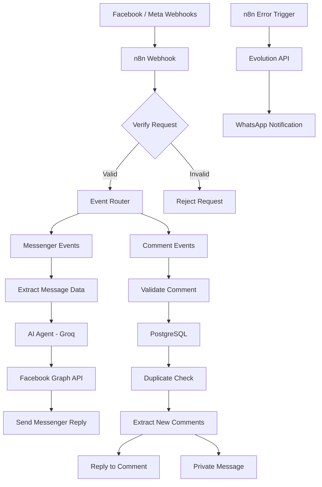

# 🤖 AI-Powered Facebook Comment & Message Responder

An intelligent Facebook automation system built with **n8n, AI, and Meta Graph API** that automates customer interactions through Facebook Messenger and post comments.

The system uses an AI Agent to generate natural, context-aware responses while PostgreSQL handles comment storage and duplicate prevention.

## 🚀 Features

### 💬 1. Automated Messenger Responses
- Automatically receives incoming Facebook Messenger messages.
- Uses an AI Agent powered by Groq to understand customer inquiries.
- Generates natural and friendly responses in Egyptian Arabic.
- Sends AI-generated replies directly through the Facebook Graph API.

### 💬 2. Automated Facebook Comment Handling
- Detects new comments on Facebook posts.
- Extracts comment details, including:
  - Comment ID
  - Post ID
  - Commenter name and ID
  - Comment text
  - Post permalink
- Automatically replies to customer comments.
- Sends a private message to the commenter.
- Ignores comments created by the Facebook Page itself.

### 🗄️ 3. PostgreSQL Integration
- Stores incoming Facebook comments.
- Prevents duplicate comment processing using a unique constraint on `(page_id, comment_id)`.
- Stores original comment payloads as JSONB.
- Maintains structured comment records for future analytics and tracking.

### 🔐 4. Webhook Security
- Handles Meta Webhook verification requests.
- Validates incoming webhook signatures using HMAC-SHA256.
- Rejects invalid signatures.
- Returns appropriate HTTP response codes.

### 🚨 5. Error Monitoring
- Uses n8n Error Trigger to detect workflow execution failures.
- Sends error notifications through Evolution API (WhatsApp).
- Includes workflow name, failed node, error message, and execution URL.

---

## 🏗️ Architecture



## 🛠️ Tech Stack

| Technology | Purpose |
|---|---|
| n8n | Workflow automation and orchestration |
| Facebook Graph API | Facebook Messenger and comments integration |
| Meta Webhooks | Receiving real-time Facebook events |
| Groq API | AI-powered response generation |
| PostgreSQL | Comment storage and duplicate prevention |
| Evolution API | WhatsApp error notifications |
| JavaScript | Data processing and custom logic |
| Docker | Self-hosted infrastructure (optional) |

## ⚙️ Prerequisites

Before running the project, make sure you have:

- A running n8n instance.
- A Facebook Page.
- A Meta Developer App with the required permissions.
- A valid Meta Page Access Token.
- A Groq API Key.
- A PostgreSQL database.
- An Evolution API instance (for WhatsApp error notifications).

## 📦 Installation & Setup

### 1. Import the Workflow

1. Download the workflow JSON file from this repository.
2. Open your n8n instance.
3. Navigate to **Workflows → Import from File**.
4. Select the downloaded JSON file.

### 2. Configure Credentials

Set up the following credentials in n8n:

| Credential | Service |
|---|---|
| Groq API | AI model access |
| HTTP Bearer Auth | Meta Graph API authentication |
| PostgreSQL | Database connection |
| Evolution API | WhatsApp notifications |
| Crypto | Webhook signature validation |

Replace any project-specific IDs, URLs, and configuration values with your own.

### 3. Configure PostgreSQL

Create the comments table:

```sql
CREATE TABLE facebook_comments (
    id BIGSERIAL PRIMARY KEY,
    comment_id TEXT NOT NULL,
    page_id TEXT NOT NULL,
    post_id TEXT NOT NULL,
    parent_id TEXT,
    commenter_id TEXT,
    commenter_name TEXT,
    message TEXT,
    comment_created_at TIMESTAMP,
    post_permalink TEXT,
    raw_payload JSONB,
    is_replied BOOLEAN DEFAULT FALSE,
    reply_message TEXT,
    UNIQUE (page_id, comment_id)
);
```

### 4. Configure Meta Webhooks

- Configure your Meta App webhook subscription.
- Set the callback URL to your n8n production webhook endpoint.
- Configure the verification token.
- Subscribe to the required Page events for messages and comments.
- Ensure the required Meta permissions are approved.

### 5. Configure AI Agent

The workflow uses Groq's `openai/gpt-oss-120b` model.

Configure your API credentials and customize the system prompt to match your business requirements and communication style.

### 6. Activate the Workflow

After configuring all credentials and testing the webhook:

1. Save the workflow.
2. Activate it.
3. Use the production webhook URL in your Meta Developer Dashboard.

---

## 🔄 Workflow Execution

**Messenger Flow:**

1. Facebook sends an incoming message event.
2. n8n extracts the sender ID and message text.
3. The AI Agent processes the inquiry.
4. Groq generates a suitable response.
5. The response is sent back through the Facebook Graph API.

**Comment Flow:**

1. Facebook sends a new comment event.
2. The workflow validates the event.
3. PostgreSQL stores the comment and prevents duplicates.
4. New comments are processed.
5. The system posts a public comment reply.
6. A private message is sent to the commenter.

---

## 🔒 Security Notes

- Never commit API keys, access tokens, or private credentials.
- Never publish your Meta App Secret or webhook verification token.
- Use n8n credentials instead of hardcoding sensitive values.
- Replace personal phone numbers, Page IDs, and private URLs before publishing.
- Keep your production credentials outside the Git repository.

## 📌 Future Improvements

- Add conversation memory for more personalized AI responses.
- Integrate a product knowledge base for accurate product and pricing information.
- Add advanced lead classification and customer intent detection.
- Build analytics dashboards for comments and messages.
- Add retry mechanisms and more advanced error handling.
- Support multiple Facebook Pages.

---

## 👨‍💻 Author

**Ziad Sakr**

AI Automation Developer

Building intelligent automation systems that connect AI, APIs, databases, and business workflows.

---

⭐ If you find this project useful, consider giving it a star!
