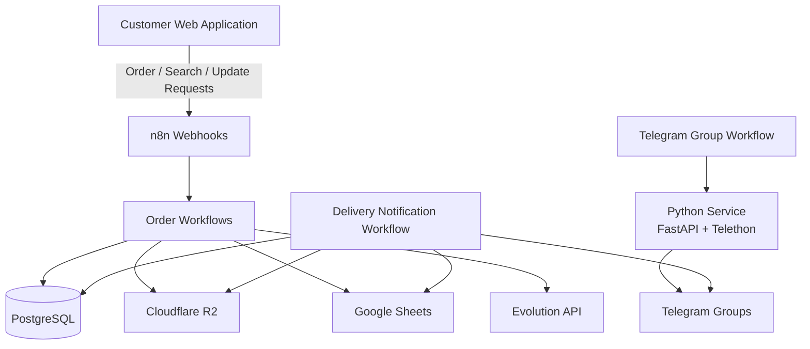
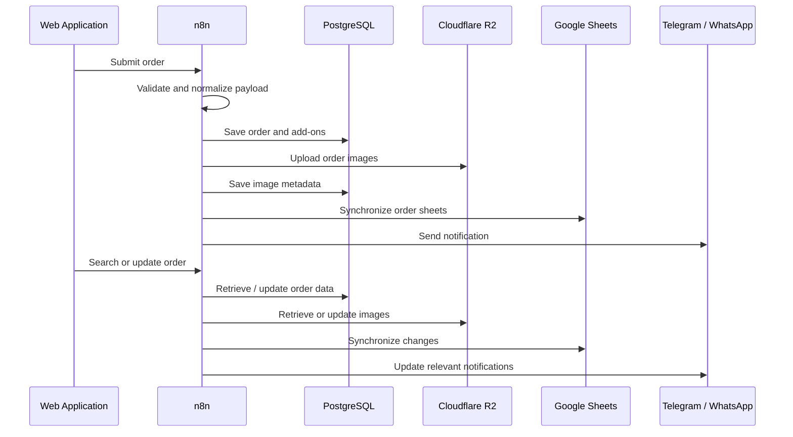

# Cake Order Management Automation

An n8n-based automation layer for a cake-order management platform. The workflows coordinate the order lifecycle across PostgreSQL, Cloudflare R2, Google Sheets, Telegram, and WhatsApp—connecting customer order submissions with internal order processing, delivery coordination, and notifications.

---

## Overview

This repository contains five n8n workflows that automate the operational side of the cake-order platform:

- **Order creation** — validates incoming order data, stores order details and add-ons, uploads images, and triggers customer/team notifications.
- **Order search** — retrieves an order using its order code and customer phone number, including its add-ons and available images.
- **Order updates** — verifies the original order, applies changes to order details and images, synchronizes records, and handles related Telegram notifications.
- **Telegram group management** — creates date-specific Cake and Delivery groups through a companion Python service.
- **Delivery coordination** — prepares daily delivery sheets and sends order details and images to the relevant Telegram groups.

The workflows are designed to work with the companion web application and database schema included in the parent project.

## Key Features

- **Automated order lifecycle:** create, search, update, and cancel orders through webhook-driven workflows.
- **Data validation:** validate required order fields, customer contact details, fulfillment information, add-ons, and payment constraints.
- **Centralized data storage:** maintain order records and related data in PostgreSQL.
- **Image management:** upload and retrieve cake/deposit images using Cloudflare R2, while keeping image metadata in the database.
- **Google Sheets synchronization:** update the main order sheet, monthly sheets, and date-specific delivery sheets.
- **Telegram operations:** create date-based Cake and Delivery groups, send order media and details, and retain message references for later updates.
- **WhatsApp notifications:** trigger notifications through Evolution API during order processing.
- **Order traceability:** keep references to Telegram messages and delivery sheets associated with each order.

## Architecture



## Workflow Directory

| Workflow file | Original workflow name | Webhook path | Responsibility |
|---|---|---|---|
| [`add-order.json`](add-order.json) | `add order` | `/create-order` | Validates and stores new orders, handles uploaded images, synchronizes sheets, and triggers WhatsApp notification. |
| [`search-order.json`](search-order.json) | `search` | `/get-order` | Finds an order using its order code and phone number and returns its details and images. |
| [`update-and-redirect.json`](update-and-redirect.json) | `update and redirect` | `/update-order` | Validates and applies order changes, manages add-ons and images, synchronizes sheets, and triggers Telegram update handling. |
| [`create-telegram-group.json`](create-telegram-group.json) | `create telegram group` | `/create-group` | Creates date-specific Cake and Delivery Telegram groups through the companion Python service. |
| [`send-telegram-create-sheet.json`](send-telegram-create-sheet.json) | `Send telegram , create sheet (first)` | `/send-messages` | Creates or updates delivery-sheet entries and sends order details and images to Telegram groups. |

## Workflow Details

### 1. Add Order

**Webhook:** `POST /create-order`

Processes new orders submitted by the web application.

1. Receives the order payload and uploaded files.
2. Validates required fields, numeric values, add-ons, fulfillment method, and discount type.
3. Checks the deposit against the order total.
4. Inserts the order into `public.orders` and its add-ons into `public.order_addons`.
5. Uploads cake and deposit images to Cloudflare R2.
6. Stores image metadata in `order_images`.
7. Synchronizes the order with the all-orders and monthly Google Sheets.
8. Triggers a WhatsApp notification through Evolution API.

### 2. Search Order

**Webhook:** `POST /get-order`

Retrieves an existing order for the web application's search and edit flow.

1. Receives the order code and customer phone number.
2. Validates the order code and Egyptian mobile number formats.
3. Looks up the order using both values.
4. Retrieves its add-ons and active image metadata.
5. Downloads available images from Cloudflare R2.
6. Returns the order details and image data.

### 3. Update Order

**Webhook:** `POST /update-order`

Updates an existing order while validating the request against the original order information.

1. Receives the order ID, order code, original phone number, updated order data, add-ons, and image instructions.
2. Validates required fields and order values.
3. Verifies the order using its ID, order code, and original phone number.
4. Checks that image operations refer to images belonging to the order.
5. Updates the order and its add-ons in PostgreSQL.
6. Handles retained, removed, and newly uploaded images in Cloudflare R2 and the database.
7. Synchronizes the all-orders and monthly Google Sheets.
8. Triggers Telegram message handling for relevant order changes.
9. Supports cancellation and the related delivery-sheet status update.

### 4. Create Telegram Groups

**Webhook:** `POST /create-group`

Creates Telegram groups for a specific delivery date.

1. Receives the date/group request.
2. Calls the companion Python Telegram service.
3. Creates the date-specific Cake and Delivery groups.
4. Stores or updates group details in `telegram_groups`.
5. Adds the group details to Google Sheets.
6. Sends the group information to the configured central Telegram group.

The workflow calls the companion service through an internal endpoint configured in the workflow and sends an `x-service-token` header.

### 5. Send Telegram Messages & Create Delivery Sheet

**Webhook:** `POST /send-messages`

Coordinates order delivery information and Telegram notifications.

1. Retrieves the order and related data from PostgreSQL.
2. Resolves the delivery date and corresponding Telegram groups.
3. Retrieves active order image metadata.
4. Creates the daily delivery sheet when it does not already exist.
5. Adds or updates the order row in the delivery sheet.
6. Stores delivery-sheet mapping information in PostgreSQL.
7. Builds the Telegram caption and media payload.
8. Sends order details and images to the Cake and Delivery groups.
9. Stores Telegram message IDs in `order_telegram_messages` for later message operations.

The workflow also contains handling for updating or deleting previously sent Telegram messages when an order changes.

## System Architecture & Data Flow



## Technology Stack

| Technology | Role |
|---|---|
| **n8n** | Workflow orchestration, webhook handling, and integrations |
| **PostgreSQL** | Orders, add-ons, image metadata, Telegram references, and delivery-sheet mappings |
| **Cloudflare R2** | Object storage for uploaded order images |
| **Google Sheets API** | Order records, monthly sheets, Telegram group records, and delivery sheets |
| **Telegram Bot API** | Order notifications and media delivery |
| **Python** | Companion Telegram group-management service |
| **FastAPI** | HTTP interface for the companion service |
| **Telethon** | Telegram client operations used by the companion service |
| **Evolution API** | WhatsApp messaging integration |
| **Docker** | Containerized local/service deployment where configured |

## Database Structure

The workflows reference the following PostgreSQL tables:

| Table | Description |
|---|---|
| `orders` | Main order records |
| `order_addons` | Add-ons associated with each order |
| `order_images` | Image metadata and Cloudflare R2 object references |
| `telegram_groups` | Date-specific Cake and Delivery Telegram groups |
| `order_telegram_messages` | Telegram message references associated with orders |
| `delivery_sheets` | Delivery-sheet metadata |
| `order_delivery_sheets` | Relationship between orders and delivery sheets |

The database schema is provided in the parent project's `web-app/database/schema.sql` file.

## Setup & Installation

### Prerequisites

Before importing the workflows, prepare:

- An n8n instance.
- A PostgreSQL database with the project schema applied.
- A Cloudflare R2 bucket and access credentials.
- Google Sheets API credentials and the required spreadsheets.
- Evolution API access for WhatsApp notifications.
- A Telegram bot and the required Telegram groups.
- The companion Python Telegram service for group creation.

### 1. Import Workflows

1. Open your n8n instance.
2. Select **Import from File**.
3. Import the five JSON files from this directory.
4. Review each workflow's nodes, webhook path, and connections.

### 2. Configure Credentials

Configure the required credentials in n8n for:

- PostgreSQL
- Google Sheets
- Cloudflare R2 / S3-compatible storage
- Telegram
- Evolution API / HTTP authentication where required

### 3. Configure Environment-Specific Values

Review and configure:

- Webhook URLs and frontend endpoints.
- PostgreSQL connection settings.
- R2 bucket name and storage credentials.
- Google Sheets document and tab identifiers.
- Telegram group/chat identifiers.
- Evolution API base URL and instance details.
- Companion Python service URL and service token.

### 4. Run the Companion Telegram Service

The group-creation workflow depends on a separate Python service using FastAPI and Telethon. Configure and run that service separately, then make sure it is reachable from the n8n runtime.

The workflow's service URL and `x-service-token` must match the running service configuration.

### 5. Test Before Activation

- Test each webhook with non-production data.
- Verify database inserts and updates.
- Verify image upload and retrieval from R2.
- Verify Google Sheets synchronization.
- Verify Telegram and WhatsApp delivery.
- Activate the workflows after the integrations have been confirmed.

> Importing the workflow JSON files does not automatically create credentials, database tables, spreadsheets, Telegram groups, or the companion Python service.

## Security

- Never commit real API tokens, passwords, Telegram session files, or private credentials.
- Store credentials in n8n Credentials or environment variables rather than hardcoding them in workflow nodes.
- The Telegram bot token in `send-telegram-create-sheet.json` is represented by the placeholder `YOUR_TELEGRAM_BOT_TOKEN`. Configure the real token securely in n8n.
- Rotate any credential that has previously been exposed.
- Restrict access to webhook endpoints and the companion service.
- Review private URLs, identifiers, and environment-specific settings before publishing.

## Repository Structure

```text
automation-workflows/
└── n8n/
    ├── README.md
    ├── add-order.json
    ├── search-order.json
    ├── update-and-redirect.json
    ├── create-telegram-group.json
    └── send-telegram-create-sheet.json
```

## Notes

- The workflow file names are simplified for repository navigation; the original n8n workflow names are listed in the workflow index.
- The web application's API workflows are maintained separately under `web-app/n8n-workflows/`.
- Configure all credentials, URLs, IDs, and service dependencies for your own environment before production use.
