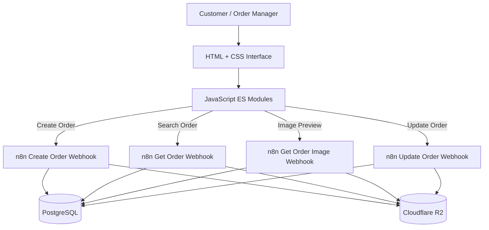

# Cake Order Web Application

A responsive, Arabic-first order management interface for creating, searching, and editing custom cake orders. The frontend is built with vanilla HTML, CSS, and JavaScript ES modules, and integrates with n8n webhooks for backend processing.

The application supports the order workflow from customer details and cake configuration to pricing, image uploads, order lookup, and order updates. PostgreSQL stores structured order data, while Cloudflare R2 is used for image object storage through the automation layer.

---

## Overview

The web application contains two primary interfaces:

- **Create Order (`index.html`)** — captures customer information, fulfillment details, cake specifications, add-ons, pricing, deposits, and reference images.
- **Search & Edit Order (`edit-order.html`)** — locates an existing order using its order code and phone number, displays its saved details and images, and submits approved changes.

The frontend communicates with n8n using `multipart/form-data`. It does not connect directly to PostgreSQL or Cloudflare R2; database and storage operations are handled by the backend workflows.

## Key Features

- **Arabic RTL interface:** customer-facing forms are designed for right-to-left Arabic content.
- **Order creation:** captures customer, delivery/pickup, cake, and payment information.
- **Dynamic cake configuration:** cake type and size selections drive the available configuration and pricing.
- **Add-ons and pricing:** supports add-on products, design extras, delivery fees, discounts, deposits, and calculated order totals.
- **Image uploads:** supports multiple cake reference images and deposit/payment images.
- **Browser-side image optimization:** large images can be resized and converted to WebP before upload, with a maximum 1800 px edge and quality setting of 84%.
- **Order lookup:** retrieves an order using its order code and customer phone number.
- **Order editing:** loads existing order data and image previews, retains selected existing images, and supports adding new images.
- **Validation:** validates required fields and user input before sending requests.
- **Modular JavaScript:** separates configuration, pricing, validation, form handling, image handling, and API payload logic.

## Application Architecture



## User Flows

### 1. Create an Order

The create-order page collects:

- Customer name and mobile number.
- Assigned moderator.
- Delivery or pickup method.
- City, area, address, delivery date, and delivery time where applicable.
- Cake type, size, tiers, filling, covering, and additional design notes.
- Cake reference images.
- Add-on products and quantities.
- Base price, design extra, delivery fee, discount, deposit, and remaining balance.
- Deposit/payment reference images.

Before submission, the frontend validates the form, calculates the order summary, prepares the request payload, and sends the data and files to the n8n create-order webhook.

### 2. Search for an Existing Order

The edit page starts with an order lookup form. The user supplies:

- Order code.
- Customer phone number.

The frontend sends both values to the search webhook. On a successful response, it populates the edit form with the saved order data, add-ons, and image metadata.

### 3. Preview and Update an Order

Existing image previews are requested through a dedicated webhook. The frontend sends the image ID together with the order code and phone number; the backend is responsible for verifying ownership and returning the image binary.

When the order is submitted:

- Existing images the user keeps are sent as IDs in `imagesToKeep`.
- Newly selected images are sent as separate binary multipart fields.
- Updated order fields and add-ons are sent with the same multipart request structure used by order creation.

The backend workflows validate the order and image ownership, then update PostgreSQL, Cloudflare R2, Google Sheets, and related notifications.

## Technology Stack

| Technology | Responsibility |
|---|---|
| **HTML5** | Structure of the create-order and edit-order pages |
| **CSS3** | Responsive layout, form styling, and RTL presentation |
| **JavaScript (ES Modules)** | Form behavior, validation, pricing, image handling, and API requests |
| **n8n** | Webhook endpoints and backend workflow orchestration |
| **PostgreSQL** | Persistent order, add-on, and image metadata storage |
| **Cloudflare R2** | Object storage for uploaded images, accessed through n8n |
| **Google Sheets API** | Order and delivery-sheet synchronization performed by workflows |
| **Node.js** | JavaScript syntax checks and automated tests |

## Project Structure

```text
web-app/
├── index.html
├── edit-order.html
├── css/
│   ├── styles.css
│   └── edit-order.css
├── js/
│   ├── config.js
│   ├── dom.js
│   ├── localization.js
│   ├── order-code.js
│   ├── order-form.js
│   ├── edit-order.js
│   ├── pricing.js
│   ├── add-ons.js
│   ├── validation.js
│   ├── summary.js
│   ├── image-uploads.js
│   └── multipart.js
├── database/
│   └── schema.sql
├── n8n-workflows/
│   ├── API-CONTRACT.md
│   ├── 01-create-order-with-orders.json
│   ├── 02-get-order.json
│   ├── 03-update-order.json
│   └── legacy-google-sheets/
└── tests/
    ├── core.test.js
    └── responsive.test.js
```

## Frontend Modules

| Module | Responsibility |
|---|---|
| `config.js` | Webhook URLs, pricing/configuration values, delivery areas, and image limits |
| `localization.js` | API payload conventions and normalization of search responses |
| `order-form.js` | Create-order form handling and submission |
| `edit-order.js` | Order lookup, form population, and update submission |
| `image-uploads.js` | New image selection, optimization, and existing-image handling |
| `multipart.js` | Builds the multipart request payload |
| `pricing.js` | Cake pricing and order total calculations |
| `add-ons.js` | Add-on product and quantity handling |
| `validation.js` | Form and field validation |
| `summary.js` | Generates the customer/order summary |
| `order-code.js` | Order code utilities |
| `dom.js` | Shared DOM helpers |

## API Integration

The frontend uses four n8n webhook operations:

| Operation | Method | Path |
|---|---|---|
| Create order | `POST` | `/webhook/lozz-cake/create-order` |
| Search order | `POST` | `/webhook/get-order` |
| Retrieve image preview | `POST` | `/webhook/get-order-image` |
| Update order | `POST` | `/webhook/lozz-cake/update-order` |

The exact request and response contract is documented in [`n8n-workflows/API-CONTRACT.md`](n8n-workflows/API-CONTRACT.md).

### Multipart Request Format

Create and update requests use `multipart/form-data`.

- Each scalar order property is sent as an independent form field.
- `addOns` is sent as a JSON string and parsed by an n8n Code node.
- `imagesToKeep` is sent as a JSON string when updating an order.
- Image files are sent as separate binary fields such as `cakeImage_1`, `cakeImage_2`, `depositImage_1`, and `depositImage_2`.
- The browser must set the multipart boundary automatically. Do not manually set the `Content-Type` header when sending `FormData`.

The frontend sends data to n8n; normalization, validation, database access, and R2 operations belong in the backend workflows.

## Database

The PostgreSQL schema is available at [`database/schema.sql`](database/schema.sql).

The frontend's backend integration uses these main tables:

| Table | Purpose |
|---|---|
| `orders` | Main order information, customer details, fulfillment, cake configuration, and payment values |
| `order_addons` | Add-on products and their quantities/prices |
| `order_images` | Image metadata, object references, and active/deleted state |

Apply the schema to the target PostgreSQL database before using the backend workflows.

## Getting Started

### Prerequisites

- A modern browser with JavaScript ES module support.
- Python 3 or a local static development server.
- Node.js for checks and tests.
- A configured n8n instance with the required webhooks.
- A PostgreSQL database initialized with the supplied schema.
- Cloudflare R2 and other backend integrations configured in n8n.

### 1. Clone the Repository

```bash
git clone https://github.com/sheetswork26-hue/n8n-projects.git
cd n8n-projects
```

### 2. Open the Web Application Directory

```bash
cd "Project4 - Cake Order Management Automation/web-app"
```

### 3. Configure Webhook URLs

Open `js/config.js` and set the webhook URLs for your n8n environment.

Do not place PostgreSQL passwords, Cloudflare R2 access keys, or other backend secrets in frontend JavaScript. Those credentials must remain in n8n.

### 4. Start a Local Development Server

From the `web-app` directory, run:

```bash
python -m http.server 5500
```

Then open:

```text
http://127.0.0.1:5500
```

You can also use VS Code Live Server. Do not open the HTML files directly through `file://`, because the application uses JavaScript ES modules.

### 5. Configure Backend Dependencies

1. Apply `database/schema.sql` to PostgreSQL.
2. Import and configure the relevant n8n workflows.
3. Configure PostgreSQL and Cloudflare R2 credentials inside n8n.
4. Configure the required webhook URLs and CORS origins.
5. Keep the R2 bucket private and serve image previews through the validating n8n webhook.

## Image Handling

- Accepted formats: JPEG, PNG, and WebP.
- The current frontend limit is 8 MB per selected image.
- Images can be resized to a maximum 1800 px edge and converted to WebP in the browser when supported.
- The original files on the user's device are not modified; the optimized upload copy is used for the request.
- Existing image metadata is returned to the frontend without exposing private R2 object keys.
- Image previews are retrieved through a backend endpoint that should verify the order code, phone number, and image ownership before returning the binary content.

## Validation & Testing

Run these commands from the `web-app` directory:

```bash
npm run check
npm test
```

- `npm run check` runs Node.js syntax checks on the frontend JavaScript modules.
- `npm test` runs the project's Node.js test files.

## Security Considerations

- Keep Cloudflare R2 credentials and PostgreSQL credentials on the backend.
- Do not expose private R2 object keys or access credentials in browser responses.
- Keep the R2 bucket private; use the image-preview webhook for authorized image retrieval.
- Configure CORS to allow only the required local and production frontend origins.
- Validate all incoming fields and recalculate/verify prices on the backend before persisting an order.
- Treat order code and phone number as lookup inputs, and verify image ownership on every image-preview/update operation.
- Review webhook URLs and environment-specific identifiers before publishing or deploying.

## Related Documentation

- [`n8n-workflows/API-CONTRACT.md`](n8n-workflows/API-CONTRACT.md) — frontend/backend request and response contract.
- [`n8n-workflows/README.txt`](n8n-workflows/README.txt) — workflow notes.
- [`database/schema.sql`](database/schema.sql) — PostgreSQL schema.
- [`../automation-workflows/n8n/README.md`](../automation-workflows/n8n/README.md) — operational n8n workflow documentation.

---

**Part of the Cake Order Management Automation project.**
